# Technical Architecture

> [!important] Reference implementation and earlier design
> [[Index]] is the active backlog. The user confirmed a continuous chunked board with separately authored artwork LOD and an explicit editing target: see [[E-002]] and [[E-006]]. The battlemat concept is retired; projector framing belongs to [[E-007]]. Earlier independent-document/footprint assumptions below are superseded where they conflict. This document is not current usability acceptance.

**Status:** earlier target architecture plus implementation reference. The development baseline is **Godot 4.8-beta2**, standard edition, and all application code **must be GDScript**. Optional GDExtensions cannot become hard dependencies or break Web export. See [archived implementation notes](Archive/2026-10-30/IMPLEMENTATION_NOTES.md) for historical checks.

## What runs today

The first sections below describe the long-term target architecture. The
**current implementation** (Godot 4.8-beta2) follows this simpler route:

```text
main.tscn
└── prefab/ui.tscn              Menu bar, sidebar, workspace and inspector
    └── scripts/interface/editor.gd          AtlasEditor: composes the workspace/session
        ├── prefab/inspector.tscn            AtlasInspector: forms emit typed intents
        ├── prefab/campaign_browser.tscn     AtlasCampaignBrowser: discovery and previews
        ├── scripts/interface/artwork_editor.gd  Scoped edits, selections and clipboard
        ├── prefab/link_dialog.tscn             Scene-owned entrance/footprint drafts
        ├── scripts/interface/linked_maps.gd    Parent-owned graph edit commands
        ├── scripts/interface/map_references.gd Bounded derived references/previews
        ├── scripts/interface/map_capture.gd    Shared private artwork renderer
        ├── scripts/navigation/map_navigator.gd Cameras, floor memory and Back
        ├── scripts/interface/canvas.gd      AtlasCanvas: draw and emit gestures
        ├── scripts/editing/                 Scope, tools, selection, clipboard
        │   ├── commands/                    Reversible operations on the graph
        │   └── history.gd                   Undo/redo/savepoint state IDs
        ├── scripts/campaign/                Campaign → map → floor → layers
        ├── scripts/artwork/                 Stroke, terrain and raster data
        ├── scripts/navigation/              Per-floor view, linked navigation
        └── scripts/persistence/             Native .scn + embedded lossless WebP
```

**Editing flow:** a pointer gesture reaches `AtlasCanvas`, which emits an
intent such as `stroke_requested`. The workspace wires it directly to
`AtlasArtworkEditor`, which resolves the active floor/layer and scope and asks
a typed command or service to validate it. `AtlasEditHistory` applies reversible changes to the in-memory
`AtlasCampaign` graph. The `changed` signal refreshes panels and the canvas.
The canvas is a view of document data; its runtime `CanvasGroup` nodes are
not the model and their count is determined by the current layers.

**Navigation flow:** `AtlasMapLink` is a directed edge. A marker-only link
uses an anchor and `hit_radius` measured in the SOURCE map's continuous board
coordinates, not screen pixels. A link with a placement uses the rotated
`AtlasPlacement` footprint instead. `AtlasMapNavigator` owns `AtlasViewSession`
and Back history for one workspace. The view session preserves each map/floor's
camera and selected layer without dirtying persisted artwork.
`AtlasZoomGate` requires three further wheel steps at the zoom boundary.
Ambiguous candidates open the scene-owned chooser and do not accumulate steps.
`AtlasLinkEdit` applies/reverts an entrance, its footprint and an optional new
document atomically. Stale geometry/endpoints and out-of-scope edits are rejected;
unlinking preserves independent destinations and shared footprints.

**Reference flow:** `AtlasMapReferences` schedules bounded floor/crop images via
`AtlasMapCapture`, shared with sidebar previews. Only the private artwork canvas
renders, with references/grid/link overlays and input disabled. Generation tokens,
content signatures and an LRU protect against stale captures. Spatial crops map
through the placement transform; symbolic links stay unregistered thumbnails.
Reference source/floor, opacity, freeze and captures are viewer state. See
[linked maps](LINKED_MAPS.md) for budgets, registration and current limitations.

**Authoring vs saving:** `examples/northern_marches.tres` is an Inspector-
editable shipped `Resource` fixture containing two map presets, two
`AtlasGrid` resources and a link resource. `AtlasCampaign.sample()` creates
independent runtime objects from that immutable asset. User-edited work is
persisted through `AtlasCampaignStore` as one compressed binary **`.scn`**,
with embedded Resource-backed domain data and lossless WebP chunks, a semantic
digest, staged verification and an adjacent verified **`.bak.scn`**. It is not
written back over the bundled `.tres`. A minimal data-only scene root owns map
document nodes; their stable IDs reconstruct the runtime registry. No standalone
`.res` or raster assets are required. Transient workspace controls, camera state
and preview renderers remain separate from saved data. Legacy JSON user saves
are neither imported nor deleted. See [native saves](Archive/2026-10-30/NATIVE_SAVE_IMPLEMENTATION.md)
for validation boundaries and [benchmarks](Archive/2026-10-30/NATIVE_SAVE_BENCHMARKS.md) for the
measured whole-file save/load costs.

**Where to begin:** to change a form, edit `prefab/*.tscn` and its
`scripts/interface/` controller. To change document rules, start with
`scripts/campaign/` and `scripts/artwork/` and add smoke-test cases. To
change an edit gesture, follow the canvas signal to `AtlasArtworkEditor` and
then `scripts/editing/commands/`. See [Code readability](CODE_READIBILITY.md)
for the concrete module ownership table.

---

## 1. Architectural goals

- Local-first and projector-first: a campaign must function without hosting a server.
- Drawing-board-first: artwork lives in continuous document coordinates; grids and optional linked maps must not dictate the drawing's scale or force navigation.
- Map content, navigation links, renderers, and editor state are separate concerns.
- Preserve independently editable maps at every semantic scale and elevation.
- Support sparse, chunked storage for large canvases.
- Make edit operations serializable/reversible, so undo, replay, autosave and future multiplayer share a common model.
- Keep unauthorized data out of player/projector output and network payloads.

## 2. Responsibility boundaries

```mermaid
flowchart LR
    subgraph UI["Godot UI / Presentation"]
        direction TB
        EditorShell
        ToolPanels["Tool Panels"]
        MapOverview
        GMViewport
        PlayerViewport
    end

    subgraph Application["Application Services (Use Cases)"]
        direction TB
        DocumentSession
        MapNavigator
        MapPreviewManager
        EditCommandBus
        EditScopeController
        AssetCatalog
    end

    subgraph Domain["Domain Model (No Node Dependence)"]
        direction TB
        Campaign
        MapDocument
        MapLink
        BattlemapPlacement
        MapFloor
        MapLayer
        GridDefinition
        MapObject
        EditCommand
        NavigationSnapshot
        AccessPolicy
    end

    subgraph Infrastructure["Infrastructure Adapters"]
        direction TB
        GodotCanvasRenderer
        GridAdapter
        ThumbnailRenderer
        ProjectStore
        ChunkStore
        ImportExport
        HostTransport
    end

    UI --> Application
    Application --> Domain
    Application -.-> Infrastructure
    Infrastructure --> Domain

    style UI fill:#dbeafe,stroke:#3b82f6,color:#1e40af
    style Application fill:#dcfce7,stroke:#22c55e,color:#166534
    style Domain fill:#fef3c7,stroke:#f59e0b,color:#92400e
    style Infrastructure fill:#f3e8ff,stroke:#a855f7,color:#6b21a8
```



**Dependency rule:** core domain objects must not require a live `Node`, `Camera2D`, or `TileMapLayer` to be valid. A Godot scene is a reusable view/tool implementation over runtime data. Tool implementations request edits through application services, not by directly modifying arbitrary scene nodes.

### Modules

| Module | Responsibilities | Not responsible for |
| --- | --- | --- |
| `CampaignRepository` | Read/write document registry, map links, assets, versions | Rendering |
| `DocumentSession` | Load active map/floor, dirty state, edit target, reference configuration | Navigation policy |
| `GridAdapter` | Convert document-to-cell, cell-to-document, snap, neighbors, polygons | Campaign links |
| `CanvasRenderer` | Render visible layers, grids, objects and reference images | Source-of-truth data |
| `ToolController` | Route pointer/keyboard input to active brush/selection/placement tool | Saving directly |
| `EditCommandBus` | Validate, apply, undo/redo, journal commands, invalidation | UI widgets |
| `EditScopeController` | Enforce selected-cell confinement using grid geometry | Drawing |
| `MapNavigator` | Link choice, zoom-boundary gate, camera history, transition lifecycle | Mutating map artwork |
| `MapPreviewManager` | Index/discover children, thumbnails, overview/search, preview visibility | Editing child content |
| `MapReferenceRenderer` | Show read-only parent underlay or child overlays | Owning canonical pixels |
| `ProjectorSession` | Player viewport, calibration, fog and allowed-content projection | Granting network authority |
| `NetworkSession` | Transport, host-owned commands, per-client projections | UI-specific navigation |
| `AssetCatalog` | Tokens, textures, brushes, external asset references | Copying artwork into document layers by default |

## 3. Core domain entities and ownership

### Campaign

Owns a registry of `MapDocument` IDs, link IDs, project assets, and project-level metadata. The graph may contain cycles or multiple entrances to a map; navigation does not assume a strict tree. A map can have many incoming links.

### MapDocument

Has stable ID, metadata, bounds or infinite-canvas policy, default grid, floors, ordered layers, and object records. It can be loaded without a parent. A battlemap is a `MapDocument` like any other, with a 5-foot grid preset and optional parent reference settings.

### MapFloor vs MapLayer

A floor is an elevation grouping (basement, ground, upper floors), each with an ordered set of layers. A layer is an editable/renderable data plane (sparse tile cells, WebP raster chunks, vector geometry, props, tokens, annotations). Floors do not represent zoom levels. Layers and floors have separate visibility and locking semantics.

### MapLink and BattlemapPlacement

A link connects a source location to a target map, with independent source hit region and target arrival camera/floor. A battlemap placement is an editable object **on the parent map** that links to an independent child battlemap. Its rotated footprint is a spatial geometry feature when aligned, or a symbolic navigation region when abstract. Link existence is separate from document existence.

### Viewer/EditorContext

Each workspace/viewer has its own active map, floor, camera, selected cell, edit-scope mode, preview preferences and navigation history. These values are **not** global properties of the map document. A projector, a GM window, and remote players may have different views.

## 4. Commands: one mutation pathway

Every persistent modification should be a typed command with immutable intent, for example:

```gdscript
PaintTileCells(mapId, floorId, layerId, cells, brushAssetId)
ApplyRasterStroke(mapId, floorId, layerId, stroke, affectedChunkIds)
PasteObjects(mapId, floorId, layerId, serializedObjects, transform)
MovePlacement(parentMapId, placementId, newTransform)
SetLayerVisibility(mapId, floorId, layerId, isVisible)
CreateMapLink(sourceMapId, targetMapId, anchors)
```

Suggested pipeline:

1. The tool calculates a proposed edit in **active document coordinates**.
2. Resolve target map, floor and layer. Validate existence, lock state, ACL and editable type.
3. Apply `EditScopeController`: filter tile cells; clip raster/vector geometry; reject or constrain object/placement transforms.
4. Convert the sanitized operation into a transaction with before/after data (or reversible sparse diffs).
5. Apply it to the document model; append to undo journal and mark affected chunks dirty.
6. Signal render cache, thumbnail cache, spatial index and autosave.
7. Eventually, a host publishes only the authorized resulting state/operation to clients.

Never trust an editor-side disabled button as permission enforcement: validation must happen in the application layer and, when networking, on the host again.

### Undo and clipboard

Undo/redo is per editing session (with commands scoped to documents). Clipboard payloads are typed: cells, raster region, objects or a composite selection, with source grid/pixel metadata. Pasting across map/grid types must use an explicit conversion policy instead of reinterpreting axial coordinates as square cells. Child-map references are not editable or copyable via ordinary painting selection.

## 5. Rendering pipeline

Recommended scene concept:

```text
EditorShell (Control)
  CampaignBrowser (Control)
  ToolPanels (Control)
  MapCanvas (SubViewportContainer or central canvas region)
    MapViewport (SubViewport)
      MapRoot (Node2D)
        ReferenceUnderlayRenderer
        LayerRenderers
        ObjectRenderer
        GridOverlayRenderer
        ChildPreviewRenderer
        SelectionAndBrushOverlay
      EditorCamera (Camera2D)
  OverviewPanel (Control)

PlayerWindow (Window; later / optional first release)
  PlayerViewport (SubViewport)
    PlayerMapRoot
    PlayerCamera
```

This is a conceptual structure; exact viewport nesting should be tested early against Godot input, window and texture behavior.

- Use `TileMapLayer` if it simplifies square/hex painting, but treat it as a renderer/cache, not the serialized truth.
- For raster art, use chunked editable images with dirty texture updates rather than one enormous image.
- Vector shapes/roads, markers and tokens are independently placed records; generate scene instances for visible objects only.
- Draw grid/selection/footprint overlays in view-space after art, so zoom does not accidentally alter source art.
- References/previews are rendered from **separate map documents** and never injected as ordinary editable layers.
- Generate cached previews when their source changes, preferably asynchronously when the runtime architecture permits; never save a low-res preview as canonical art.

## 6. Editing versus presentation

**Editor view** shows all GM-authorized layers plus editing chrome. **Player view** shows only allowed layers, revealed map regions and permitted objects. Store per-view camera and optional follow-host/follow-GM controls. Calibrate projected grid size independently of stored document cell size: pixels are not physically meaningful inches on a projector.

For a single-machine projector, do not assume merely hiding nodes in the GM view is enough. Build player-visible draw data from an explicit projection filter so it can later be reused for remote clients.

## 7. Persistence and large-map handling

- Campaign storage is a versioned directory/bundle with JSON metadata and content chunks; see [Data model](DATA_MODEL.md).
- Use stable UUID-like string IDs rather than filenames/array offsets to refer to documents, layers, placements and links.
- Store raster chunks, sparse tile chunks, object lists and thumbnails independently for efficient partial loading.
- Dirty tracking occurs at document and chunk granularity. Save atomically via temporary files/manifest swap or equivalent recovery technique.
- A command journal can support autosave/recovery; periodically checkpoint and compact it.
- Never persist transient viewport caches or presentation-only preview GPU textures as source-of-truth data.

## 8. Multiplayer-ready security model (later phase)

Host authoritative. Client sends a semantic command request; host checks role, map access, layer permissions, object ownership, editable region and revision/ordering rules. Host applies allowed edits and distributes only content the recipient may know. A role matrix can begin with GM, editor/co-GM and player. ACL dimensions should include view, edit, reveal, move-token, create-link and manage-floor.

**Do not send hidden content and then hide it locally.** GM notes, secret objects, unexplored fog and generated preview images must be filtered before serialization or network delivery. Local projector and online views should share the content-projection policy; unauthorized preview caches need separate identities or isolated storage.

Initial collaboration can be host-sequenced commands with conflict rejection or rebase; CRDTs and simultaneous pixel edits are explicitly deferred.

## 9. Cross-cutting performance and failure behavior

- Keep in-memory load bounded by visible area, neighboring prefetch and preview budget.
- Spatially index placements/anchors on loaded maps; query visible cells rather than recursively loading every child document.
- Use an ID/index lookup for finding descendants by name/tags; bound graph traversal depth and prevent cycles.
- Failed child load/permission check leaves active document and history untouched.
- Cancellation of a zoom transition restores the source camera and preview.
- Corrupt chunks are reported per map; do not silently discard the rest of the campaign.
- Add schema-migration tests and save/load roundtrips before accepting large-map edits.

## 10. Recommended implementation conventions

Use typed **GDScript** for the domain and all core features. GDExtensions may be optional accelerators only with WebAssembly builds and fallback paths; no mandatory native-only library, OS-specific file API or threads in the core. Godot Compatibility renderer / single-thread web export is the baseline. Canonical raster payloads use lossless **WebP** embedded in the campaign scene; derived thumbnails may be lossy.

See [Maps and grids](MAPS_AND_GRIDS.md) for reference geometry and [Semantic zoom](SEMANTIC_ZOOM.md) for the previous navigation model. Current work/acceptance is tracked in [[Index]]; the [previous implementation plan](Archive/2026-10-30/IMPLEMENTATION_PLAN.md) is archived.
